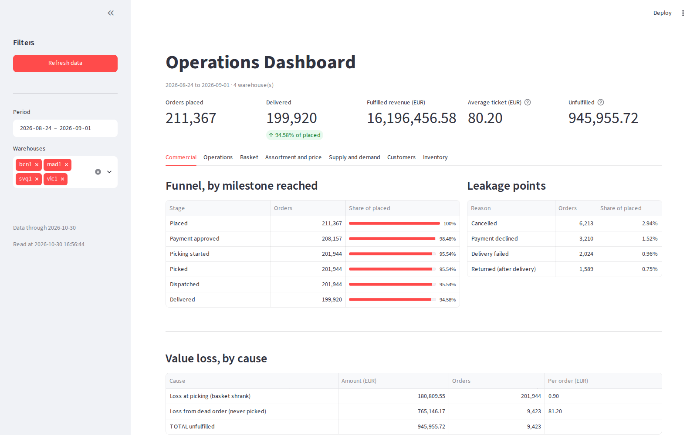
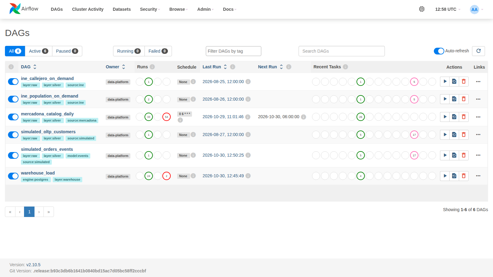
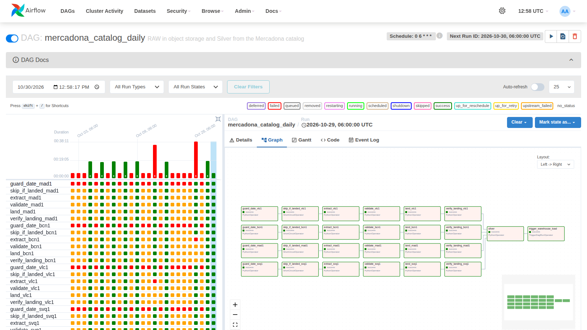
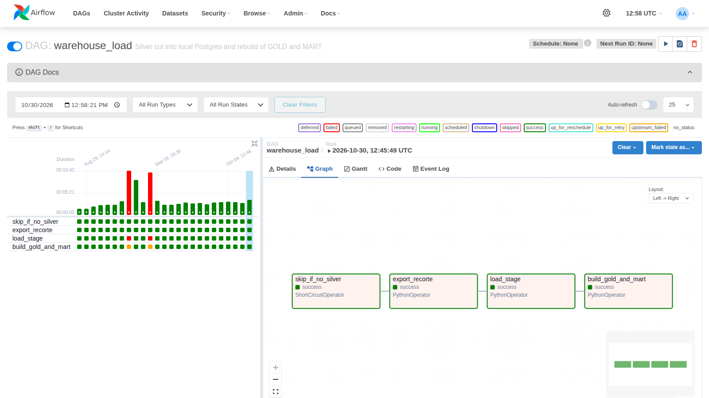
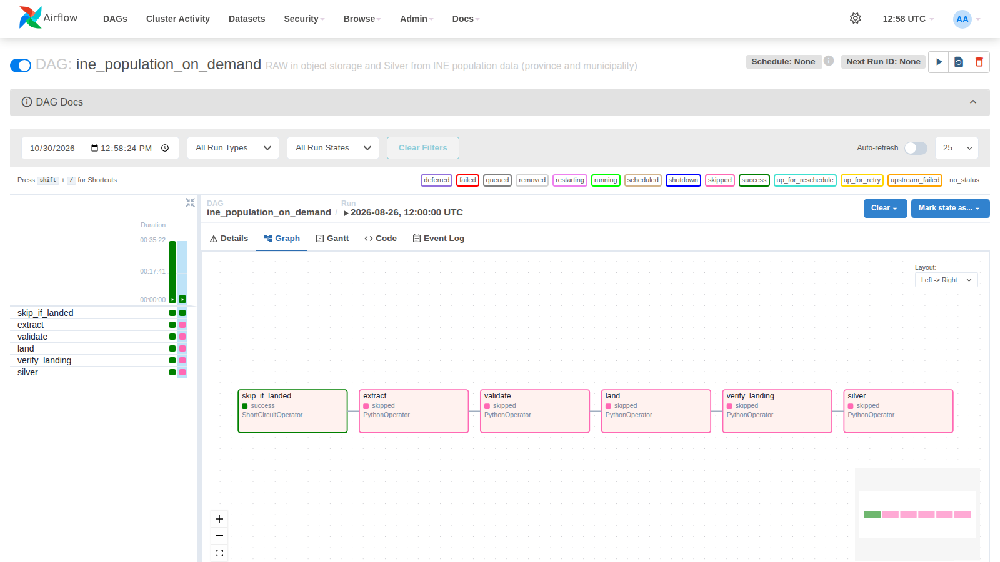
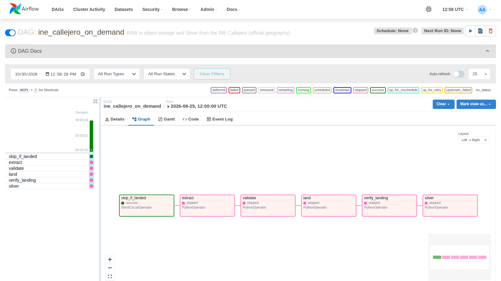
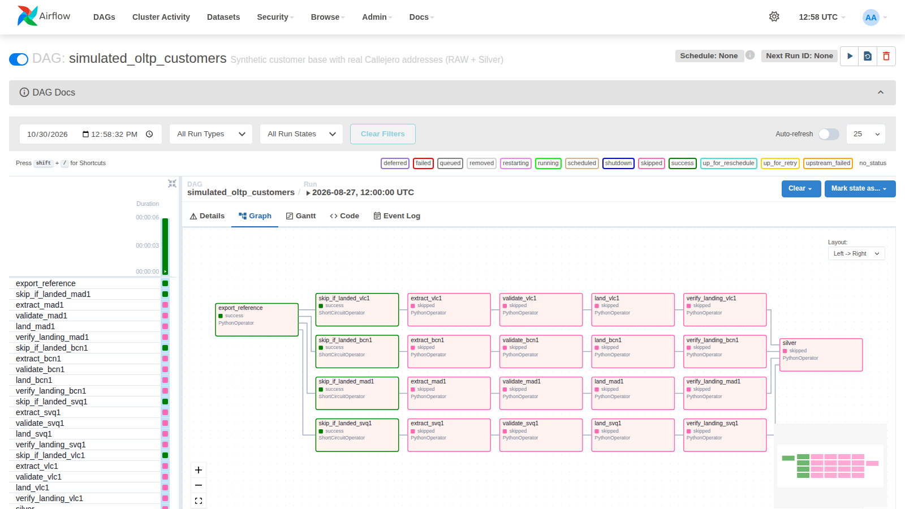
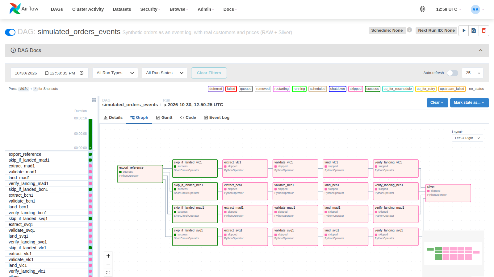

# Retail Lakehouse — Mercadona + INE

A data-architecture demonstration that ingests public Spanish retail and census data
(Mercadona's catalog and prices, INE population and official geography), keeps it
byte-for-byte in object storage, models it with dbt on DuckDB, and serves a dimensional
warehouse and two dashboards — with synthetic customers and orders flowing, on demand,
through an OLTP → Kafka → Iceberg stream plane.



The customer is invented, the address where they live is not; the order is invented, but
who buys, what is bought, and how much it costs is not. Every Source is a **frozen,
independent** package under [`sources/`](sources/) with its own physical contract
(`CONTRACT.md`) and **zero runtime dependencies** — the platform consumes the files they
write, never their code. See [DECISIONS.md § "Second source: INE population"](DECISIONS.md)
for why they are sibling packages, not a shared abstraction.

**Where to read next.** [ARCHITECTURE.md](ARCHITECTURE.md) is the current state — layers,
each technology's adoption date and trigger, declared debt. [DECISIONS.md](DECISIONS.md) is
the dated history — decision, reason, evidence, trade-off. [BACKLOG.md](BACKLOG.md) is what
does not get in. [docs/operations.md](docs/operations.md) is how to run and inspect it.

## Layers

```
L0  Source     API -> canonical partition, manifest with sha256, validate --strict
               5 FROZEN packages; 4 deliver a snapshot, simulated_orders delivers a LOG
L1  RAW        byte-identical partition in MinIO/S3, checksum verified post-PUT
    ┌──── operational plane, on demand (make stream-up) ────────────────────┐
    │ OLTP   Postgres: orders, order_line, outbox                           │
    │        state + event IN THE SAME transaction, one transaction/event   │
    │ Broker Kafka retail.orders.events.v1 — 4 partitions, key = order_id   │
    │ Read   Postgres OR Iceberg: live_order_state                          │
    │ model  dedup by (order_id, sequence_no); TWO writers to Iceberg,      │
    │        with monotonic merge — whatever doesn't advance seq is dropped │
    └───────────────────────────────────────────────────────────────────────┘
L2  Silver     typed parquet + order fold + price variation · DuckDB · 11.7 M rows
────────────── physical boundary: COPY INTO, never ref() ──────────────
L3  Stage      1:1 mirror of a CUT of the Silver           · Postgres (default) · 7.7 M rows
L4  Gold       conformed DIM_* / FACT_*, SCD2 history
L5  Mart       MART_*, with the grain declared in each table
```

The analytical warehouse does **not** receive the whole Silver: 7,732,735 of 11,658,778 rows
cross the boundary (**66.3%** on 2026-10-30, over the 18 Silver tables). The ratio **is not
a property of the pipeline** — it's a function of how much of each source falls within the
geographic scope, which is why it moved on its own (3.85% in Phase 2, 46.9% on 2026-09-01)
with nobody loosening the cut. The INE population is national and delivers 1.8%; orders and
customers are born inside the four urban areas and deliver ~100%. See
[DECISIONS.md § "Phase 2"](DECISIONS.md).

**The engine behind L3-L5 is Postgres by default; Snowflake is one `--target` away.** Same
24 models, same data tests — only the loader and the target change. Why the boundary makes
that a configuration switch, and how it was exercised for real twice, is told once in
[ARCHITECTURE.md § "Warehouse destination"](ARCHITECTURE.md).

## Quickstart

Requirements: Python 3.12, Docker with Compose v2. The standard path does **not** need
Airflow, Kafka, Iceberg or Spark — `make up` starts **only** MinIO and its buckets, and
whatever depends on an optional plane leaves the Silver build on its own (`silver_gate.py`
decides it in one place; a test proves `make silver` stays green on a tree where Spark never
ran).

```bash
# 0. setup
cp .env.example .env && make secrets   # random keys; compose refuses to start without them
make venv                              # platform/.venv with the platform installed
make help                              # every target, one per line

# 1. data plane: MinIO, the five Sources, Silver
make up                                # MinIO + buckets only
make daily                             # Mercadona: extract -> validate -> land -> verify -> silver
make ine-refresh                       # INE population (live API)
make callejero-refresh                 # INE Callejero — needs the manual download in temp/
make oltp-export-reference && make oltp-refresh-all       # synthetic customers
make orders-export-reference && make orders-refresh-all   # synthetic order event log
make silver && make test               # full Silver build; every offline suite

# 2. warehouse and dashboards (Postgres container, no account needed)
make warehouse-postgres-up             # the warehouse container (compose profile)
make warehouse-refresh                 # cut -> bootstrap roles -> load -> dbt build
make dashboard-venv                    # once: streamlit/pandas/altair
make dashboard                         # operations panel:  http://localhost:8501
make price-dashboard                   # price-watch panel: http://localhost:8502

# 3. optional planes
make demand-reality-check              # demand calibration against the MAPA 2025 benchmark
make stream-up                         # OLTP + Kafka; then orders-apply-all, orders-publish,
make orders-reconcile                  #   orders-project — and three folds must agree
make check-spark-iceberg               # Spark gate: does it read pyiceberg's catalog?
make stock-ledger                      # the Spark job: consumption -> balance, stockout, reorder
make airflow                           # the six DAGs, on :8080

# 4. close
make freeze && make freeze-check       # seal the RAW capture, and confirm it hasn't changed
```

The full stream sequence, the Silver gate's output, querying the DuckDB views, disk usage,
and container details are in [docs/operations.md](docs/operations.md).

## The fourteen closing questions

This is an **index**, not a new explanation: each answer fits on one line and points to
where the evidence lives. It exists so a reader can check, without reading 3,000 lines,
whether the documentation backs up what it claims.

| | Question | Short answer | Where the evidence lives |
|---|---|---|---|
| 1 | What does the project do? | Ingests 5 sources, preserves the RAW, produces typed Silver, serves a dimensional model, and keeps a stream plane that converges to the same state as the batch | [Layers](#layers) |
| 2 | Which data is **real**? | Mercadona's catalog and price; INE population; INE geography (sections, streets, clusters); the MAPA 2025 report, used as a **benchmark** | [The five Sources](#the-five-sources) · [`docs/README.md`](docs/README.md) |
| 3 | Which data is **synthetic**? | Customers and orders — invented over real attributes (the address exists, the person doesn't); and the **stock ledger**, computed from observed consumption plus a policy in a seed. No source in this repository measures stock | seeds `*_premises_seed.csv`, all with a provenance column · `stock_label = 'synthetic'` in `MART_STOCK_HEALTH` |
| 4 | Why does each technology exist? | Each one has an adoption date, the trigger that fired it, and what **wasn't** proven | [ARCHITECTURE.md § "What didn't get in, and when it gets in"](ARCHITECTURE.md) |
| 5 | Why does Spark exist while **being slower**? | Three reasons, and performance is not one of them: cumulative state whose output depends on the prior state; Iceberg interop demonstrated by a check; and the need to validate more than one engine writing the same catalog. At this volume pure Python is ~3× faster, and the number is published | [`docs/spark-evidence/`](docs/spark-evidence/README.md) · [DECISIONS.md § "Phase 7"](DECISIONS.md) |
| 6 | What is **Kafka's** role? | **Transport**, never the canonical source. `publish → broker ack → mark the outbox`, at-least-once, with the duplication window reproduced in a test | [`docs/stream-evidence/`](docs/stream-evidence/README.md) |
| 7 | What is **Iceberg's** role? | Atomic commit with optimistic concurrency between writers, and **interop between engines** — asserted in Phase 3, demonstrated in Phase 7 with three writers on the catalog (`platform`, `rebuild`, `spark`) | `make orders-prove-projection` · `make check-spark-iceberg` |
| 8 | What is the **system of record** at each stage? | RAW in object storage is the point of no return; the OLTP is the origin of the event (state + outbox in the same transaction); Kafka is transport; the projection and the Silver are **derived** and disposable | [L1 — RAW](docs/operations.md#l1--raw-in-object-storage) · [ARCHITECTURE.md](ARCHITECTURE.md) |
| 9 | How does it handle **duplication**? | Consumer-side dedup by `(order_id, sequence_no)`: `seq <= last` is discarded. Duplication in the window between publishing and marking the outbox is **accepted and declared** — end-to-end exactly-once is not promised | `make orders-prove-stream` · `fake_kafka.py` |
| 10 | How does it handle **gaps**? | `seq == last + 1` applies; `seq > last + 1` is a gap and **stops** instead of applying out of order | `make orders-prove-stream` |
| 11 | How does it handle **concurrency**? | Optimistic conflict on Iceberg with the full cycle: detect → reload → reapply → retry, and an old `seq` **never** overwrites a newer `seq`. Demonstrated even **across different engines** | `make orders-prove-projection` · `make check-spark-iceberg` |
| 12 | How does it know the **folds agree**? | `make orders-reconcile` closes across all three paths — batch, Iceberg projection, and Postgres sink — over 211,367 orders. It was disagreement between folds that found **three** real defects in this project | [Verification](#verification) |
| 13 | How does it know the **RAW hasn't changed**? | `make freeze` seals `(path, sha256, bytes, records)` for 167 partitions into a `capture_id`; `make freeze-check` re-reads the RAW and exits 1 on any difference | [`docs/FREEZE.md`](docs/FREEZE.md) |
| 14 | What **limitations** remain? | Eight debt items (three open), each with problem, impact, status, and next step; plus the scope that requires a new source | [ARCHITECTURE.md § "Technical debt"](ARCHITECTURE.md) · [BACKLOG.md](BACKLOG.md) |

### What is **not** demonstrated in this project

Written in these words on purpose. The absence of proof is information, and erasing it
would be the only way to make this list look nice:

- **That Spark scales.** It runs `local[*]` — driver and executor on the same JVM, no
  shuffle between nodes. **Not demonstrated in this project.**
- **That anyone needs Kafka's latency, or that the broker is the origin.** The canonical
  log still originates on disk. **Not demonstrated in this project.**
- **End-to-end exactly-once.** It isn't promised, and the window where duplication happens
  is reproduced in a test rather than hidden.
- **That the RAW is reproducible.** It isn't, by the nature of the sources. What's
  guaranteed is `same frozen RAW → reproducible downstream`.
- **That the operation is production-grade.** There's no real traffic, SLO, on-call, or
  incident. What exists is behavior verified in tests and dated execution evidence.
- **That purchasing behavior is realistic.** Customer and order are synthetic, calibrated
  against a **benchmark** that is never treated as ground truth.

## The five Sources

Each is a **frozen** Python package, with `dependencies = []`, its own physical contract
(`CONTRACT.md`), and its own README. **The reasoning behind each one is in
[DECISIONS.md](DECISIONS.md);** here is what each delivers and how to run it.

| Source | What it delivers | Real or synthetic | How to run it |
|---|---|---|---|
| [`mercadona-catalog-source`](sources/mercadona-catalog-source/) | Catalog and price per warehouse and day, from Mercadona's public API | **observed** | `make extract validate land verify-landing WH=mad1` |
| [`ine-population-source`](sources/ine-population-source/) | Population by province (with age and sex) and by municipality (sex only), from the INE's Tempus3 API | **observed** | `make ine-refresh` |
| [`ine-callejero-source`](sources/ine-callejero-source/) | Census sections, population units, streets and segments — with postal code and numbering range | **observed** (manual, twice-yearly download) | `make callejero-refresh` |
| [`simulated-oltp-source`](sources/simulated-oltp-source/) | Customer base, anchored to the real population of the municipality and the real address of the street segment | **synthetic over observed geography** | `make oltp-export-reference && make oltp-refresh-all` |
| [`simulated-orders-source`](sources/simulated-orders-source/) | Order **event log** — not a state snapshot | **synthetic over observed catalog and customers** | `make orders-export-reference && make orders-refresh-all` |

**The real/synthetic distinction is not a footnote.** It travels with the data:
`label = 'synthetic'` on every assumption, `stock_label` on every row of the stock mart,
`kind` on every indicator, and the operations catalog's *Out of scope* list states what
**cannot** be asked. A platform that mixes the two without a label invites reading
simulation density as market penetration.

**The five derived seeds** have a Makefile target and reproduce byte for byte — a
versioned artifact with no command that generates it is indistinguishable from a
hand-typed number: `make seed-province-map`, `make seed-service-area`,
`make seed-municipality-codes`, `make seed-ambiguous-series` and
`make seed-online-propensity` (the last three call the INE).

## Analytical warehouse

`make warehouse-refresh` runs three separate verbs — `warehouse-export` cuts the Silver to
local parquet without talking to the warehouse, `warehouse-load` transports it and re-checks
count against count, `warehouse` runs `dbt build` — because a cut failure is a data failure
and isn't retryable, while a load failure is network and is. The pipeline **wears** three
roles (`retail_loader` writes STAGE, `retail_transformer` writes GOLD/MART, `retail_reader`
reads MART only), never the database superuser. The engine choice, the role matrix, the
Snowflake path (`make warehouse-snowflake-*`, dated evidence in
[`docs/warehouse-evidence/`](docs/warehouse-evidence/README.md)) and why there is no DuckDB
mirror of the warehouse models are in
[ARCHITECTURE.md § "Warehouse destination"](ARCHITECTURE.md).

## Two dashboards over one indicator catalog

| Panel | Who it's for | Reads |
|---|---|---|
| **Operations** (`make dashboard`, port 8501) | whoever looks at the business: KPI, table, chart, no SQL on screen. 22 indicators in 7 groups | the `MART` only |
| **Price-watch** (`make price-dashboard`, port 8502) | Mercadona price oscillation — drops, rises, daily movement, category dispersion. 9 indicators | two marts, on purpose |

Both connect as `retail_reader` (`streamlit/connection.py`), cache for 60 s with a refresh
button, and show the most recent date the marts cover.

**The panels are consumers; the catalog is the asset.** Every query lives in
[`platform/src/retail_platform/indicators/`](platform/src/retail_platform/indicators/) next
to its explanation — `model.py` (the `Indicator` dataclass and the bound filters),
`operations.py` (plus `OUT_OF_SCOPE`, each absence with the trigger that would unlock it),
`prices.py`, and `contract.py`, the single generator. Each indicator declares its question,
source grain, `kind` (observed / synthetic / mixed / derived), caveats, and SQL whose
parameters are always bound. `make indicators-contract` regenerates the reviewable pages
[`docs/indicators/operations.md`](docs/indicators/operations.md) and
[`docs/indicators/prices.md`](docs/indicators/prices.md) without connecting to anything, and
an offline test fails if they drift. The catalog sits in the platform package, not in
`streamlit/`, because its next consumer is an LLM/RAG layer: the same fields that stop a
human from rebuilding a measure wrong are what a language model needs to answer from it.

Three examples of the caveats the catalog records:

| Caveat | The error it avoids |
|---|---|
| Value loss has **two** causes | `SUM(gross) − SUM(net)` mixes a basket that shrank at picking with an order that died before that — causes from different areas |
| Average ticket has **two** denominators | revenue/picked ≠ revenue/placed — the second measures something that doesn't exist |
| `orders_touching_category` **isn't additive** | summing a day's categories gives far more than that day's orders |

The most actionable gap: **no mart joins customer with order** — the link exists in
`FACT_ORDER.customer_sk`, in GOLD, out of `retail_reader`'s reach by design (debt item #4).
`make dashboard-check` renders both panels with `AppTest` against the live warehouse and
demands zero exceptions. Details in [`streamlit/README.md`](streamlit/README.md).

## Orchestration — the six pipelines, run on 2026-10-30



| | |
|---|---|
|  **`mercadona_catalog_daily`** — the first *scheduled* run to succeed: the red `guard_date` row is every earlier scheduled run, refused until CR-016 |  **`warehouse_load`** — triggered by the daily DAG: cut → load `STAGE` → `dbt build` GOLD/MART on Postgres |
|  **`ine_population_on_demand`** — run on the landed release: the gate verifies the destination and skips the rest |  **`ine_callejero_on_demand`** — same: no re-download, no duplicate partition |
|  **`simulated_oltp_customers`** — reference re-exported, the four sealed partitions verified, nothing regenerated |  **`simulated_orders_events`** — the sealed 9-day window re-verified across four warehouses |

Pink is `skipped`: an on-demand DAG run on data that already landed must change nothing, and
the short-circuit proving the destination intact is the evidence.

## Language

Everything written for this repository — docs, code, comments, CLI output, tests — is in
English. Only the source data and the Spanish domain terms it carries stay as they are:
Mercadona category and product names, INE labels, and values such as the
`preco_alterado` `change_type`.

## Structure

```
.
├── ARCHITECTURE.md      # state: layers, adopted tech with trigger and date, declared debt
├── DECISIONS.md         # history: decision -> reason -> evidence -> trade-off, phase by phase
├── BACKLOG.md           # what does NOT get in, and each item's trigger
├── Makefile              # the platform's entry point — `make help` lists every target
├── sources/               # 5 FROZEN packages, dependencies = [], each with its own CONTRACT.md
├── .env.example           # copy to .env; development-only credentials
├── .env.snowflake.example # copy to .env.snowflake; account identity, no secret
├── docs/
│   ├── operations.md      # running and inspecting the platform
│   ├── indicators/        # GENERATED from the indicator catalog (`make indicators-contract`)
│   └── screens/           # screenshots of the dashboards and of each proof
├── platform/
│   ├── pyproject.toml     # boto3, duckdb, dbt-core, dbt-duckdb, dbt-snowflake, dbt-postgres
│   ├── src/retail_platform/  # land/verify/query, the warehouse cut and loaders, the two orders
│   │   │                     # planes, demand calibration, and the CLI that wires it together
│   │   └── indicators/    # the indicator catalog: SQL + explanation, one generator
│   ├── dbt/seeds/         # 17 seeds, all with a provenance column
│   ├── dbt/models/silver/     # target dev (duckdb) — 25 models, one tree per source
│   ├── dbt/models/warehouse/  # target postgres (default) or snowflake — 24 models via source()
│   ├── dbt/tests/ + dbt/tests/warehouse/  # singular tests, Silver and Gold/Mart separately
│   └── tests/              # no network — in-memory doubles of S3, Postgres, Kafka, Iceberg
├── orchestration/airflow/dags/  # 6 DAGs: 5 sources + warehouse_load
├── streamlit/              # the two panels over the MART, as retail_reader
│   ├── operations_app.py / prices_app.py   # the interfaces; no SQL of their own
│   ├── connection.py                       # the read-only session, shared by both
│   ├── display.py                          # one number format for both panels
│   └── smoke.py                            # AppTest render check (`make dashboard-check`)
├── scripts/                # one Makefile target each; provenance, checks, and adversarial proofs
├── jobs/spark/              # the only code that runs outside the platform's venv
├── infra/                   # docker-compose.yml, Dockerfile.airflow, Dockerfile.spark
└── data/                    # extraction scratch, outside version control
```

## Verification

```bash
make test          # 1,175 tests on 2026-10-30, no network: 145 Mercadona + 136 INE population
                   #   + 95 Callejero + 140 simulated OLTP + 178 orders + 481 platform
make silver        # dbt build on DuckDB: 25 models + 17 seeds + the data tests
make warehouse     # dbt build on Postgres (default): 24 models + the data tests
```

`make test` and `make silver` read no warehouse variable — that's what keeps the Lakehouse
half reproducible whether or not either warehouse engine is configured. CI runs the same
offline half (`.github/workflows/ci.yml`).

The two dbt trees are **mutually exclusive per target** (`+enabled` guard in
`dbt_project.yml`): `--target dev` sees only the Silver, `--target postgres`/`snowflake`
only the warehouse.

Every check was proven **able to fail**: tampering with one byte at the destination fails
`verify-landing` with exit 1; removing a catalog object fails the reconciliation test. The
acceptance numbers for the first partitions are in
[docs/operations.md](docs/operations.md#acceptance-numbers-for-the-first-partitions).
